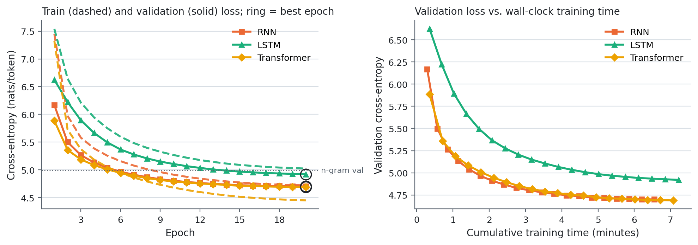
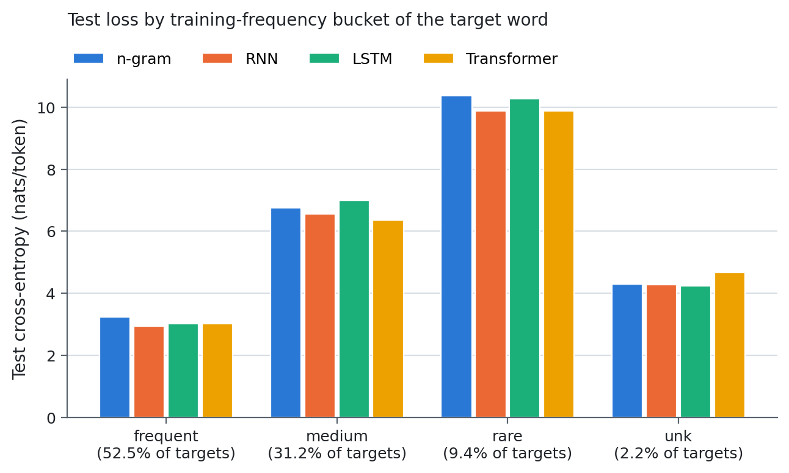
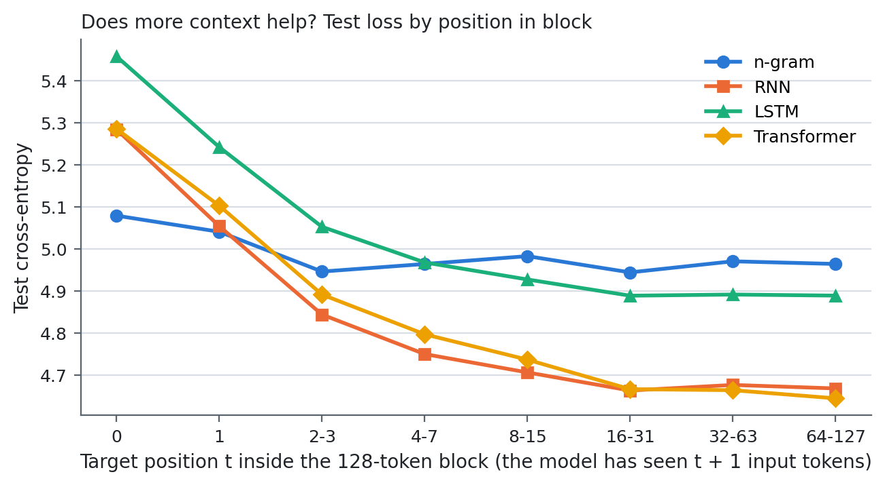

# Part I results

Common evaluation: 585,134 test targets (padding excluded), identical for every model.

## Quality and cost

| Model       |   Test CE |   Test PPL | PPL 95% CI       |   Val PPL | Params (total)           | Core params   |   Train time (min) |   Time to best (min) | Epochs (best/run)   |   Size (MB) |   Scoring tok/s | Device   |   Generation tok/s |
|:------------|----------:|-----------:|:-----------------|----------:|:-------------------------|:--------------|-------------------:|---------------------:|:--------------------|------------:|----------------:|:---------|-------------------:|
| n-gram      |     4.966 |      143.4 | [140.94, 145.80] |     146.6 | 1,321,723 n-gram entries | -             |              0.002 |                0.012 | -                   |        25.9 |         1281112 | Tesla T4 |             1539   |
| RNN         |     4.686 |      108.4 | [106.51, 110.20] |     110   | 8,312,597                | 248,832       |              6.55  |                6.55  | 20/20               |        31.7 |          261248 | cuda     |              466.7 |
| LSTM        |     4.904 |      134.9 | [132.75, 137.18] |     137.1 | 9,059,093                | 995,328       |              7.22  |                7.22  | 20/20               |        34.6 |          219763 | cuda     |              535.4 |
| Transformer |     4.676 |      107.3 | [105.38, 109.09] |     108.8 | 8,066,845                | 965,600       |              7.07  |                7.07  | 20/20               |        30.8 |          269243 | cuda     |              410.3 |

Train time = wall-clock training (n-gram: counting). Time to best = up to the checkpoint used for evaluation. Scoring tok/s = common workload (all test targets, 128-token blocks). Check the Device column before comparing times.

## Paired bootstrap: test CE difference (A - B), 95% CI over blocks

| model_a   | model_b     |   ce_a_minus_b |   ci_low |   ci_high | ci_excludes_zero   |
|:----------|:------------|---------------:|---------:|----------:|:-------------------|
| n-gram    | RNN         |         0.2803 |   0.2746 |    0.2859 | True               |
| n-gram    | LSTM        |         0.0614 |   0.0548 |    0.0679 | True               |
| n-gram    | Transformer |         0.2903 |   0.2849 |    0.2959 | True               |
| RNN       | LSTM        |        -0.2189 |  -0.2227 |   -0.2149 | True               |
| RNN       | Transformer |         0.0100 |   0.0054 |    0.0150 | True               |
| LSTM      | Transformer |         0.2289 |   0.2225 |    0.2355 | True               |

## Test CE by frequency bucket

| Bucket                        |   Share of targets |   n-gram |   RNN |   LSTM |   Transformer |
|:------------------------------|-------------------:|---------:|------:|-------:|--------------:|
| frequent                      |              0.525 |    3.227 | 2.933 |  3.024 |         3.018 |
| medium                        |              0.312 |    6.763 | 6.555 |  6.985 |         6.360 |
| rare                          |              0.094 |   10.374 | 9.887 | 10.261 |         9.874 |
| unk                           |              0.022 |    4.307 | 4.287 |  4.231 |         4.672 |
| general words (GloVe top-50k) |              0.850 |    4.761 | 4.486 |  4.692 |         4.492 |
| domain words                  |              0.081 |    9.065 | 8.676 |  9.202 |         8.404 |

## Test CE by position in block

| Positions   |   Targets |   n-gram |   RNN |   LSTM |   Transformer |
|:------------|----------:|---------:|------:|-------:|--------------:|
| 0           |      4572 |    5.079 | 5.284 |  5.457 |         5.285 |
| 1           |      4572 |    5.041 | 5.054 |  5.242 |         5.103 |
| 2-3         |      9144 |    4.946 | 4.844 |  5.053 |         4.892 |
| 4-7         |     18288 |    4.964 | 4.750 |  4.968 |         4.797 |
| 8-15        |     36576 |    4.983 | 4.707 |  4.928 |         4.737 |
| 16-31       |     73152 |    4.944 | 4.664 |  4.889 |         4.667 |
| 32-63       |    146286 |    4.971 | 4.677 |  4.892 |         4.664 |
| 64-127      |    292544 |    4.964 | 4.669 |  4.889 |         4.645 |

## Generated text metrics (25 samples x 50 tokens per model)

| Model       |   distinct_1 |   distinct_2 |   repeated_trigram_rate |   unk_rate |   num_rate |   generation_tokens_per_second |
|:------------|-------------:|-------------:|------------------------:|-----------:|-----------:|-------------------------------:|
| n-gram      |        0.673 |        0.967 |                   0.001 |      0.021 |      0.090 |                       1538.906 |
| RNN         |        0.702 |        0.943 |                   0.007 |      0.022 |      0.047 |                        466.716 |
| LSTM        |        0.702 |        0.955 |                   0.005 |      0.032 |      0.037 |                        535.362 |
| Transformer |        0.707 |        0.931 |                   0.018 |      0.007 |      0.054 |                        410.294 |

Side-by-side samples: results/generation/samples.md

## Figures

