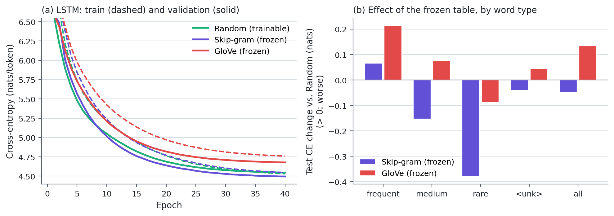

# Part II results: LSTM input-embedding ablation

## Embeddings

Skip-gram training (train split only): 173.5 s on Tesla T4 host CPU, 1,603,305 tokens.

Vocabulary type coverage:

| Words     |   skipgram |   glove |
|:----------|-----------:|--------:|
| all words |      1.000 |   0.795 |
| frequent  |      1.000 |   1.000 |
| medium    |      1.000 |   0.987 |
| rare      |      1.000 |   0.756 |

OOV rule: N(0, sigma^2), sigma = std of covered vectors (Skip-gram 0.184, GloVe 0.423). Mean norms: Skip-gram 2.46, GloVe 5.92, random N(0,1) init ~14.14.

GloVe-missing examples: <unk>, <eos>, <num>, normotensive, echocardiographic, transesophageal, 99m, doxazosin, electrocardiographic, ptca, cirrhotic, msec, transluminal, reoperation, cytologic

## Quality, cost, convergence, stability

| Setting            |   Test PPL | PPL 95% CI       |   Val PPL | Best/run epochs   | Trainable params   |   LM train (min) |   Embedding training (s) |   Vocab coverage |   Val CE ep1 |   Val CE ep5 |   Val CE ep10 |   Val CE ep20 |   Epochs to common level |   Grad norm mean |   Grad norm max |   Epochs clipped |   Non-finite steps |   Train-val gap |
|:-------------------|-----------:|:-----------------|----------:|:------------------|:-------------------|-----------------:|-------------------------:|-----------------:|-------------:|-------------:|--------------:|--------------:|-------------------------:|-----------------:|----------------:|-----------------:|-------------------:|----------------:|
| Random (trainable) |      92.55 | [91.00, 94.12]   |     94.21 | 40/40             | 9,059,093          |            15.84 |                      0   |           1      |        6.623 |        5.481 |         5.05  |         4.687 |                       21 |           0.1699 |          0.4287 |                0 |                  0 |         0.0151  |
| Skip-gram (frozen) |      88.14 | [86.71, 89.56]   |     89.68 | 39/40             | 5,530,093          |            15.46 |                    173.5 |           1      |        6.616 |        5.567 |         5.017 |         4.639 |                       18 |           0.1934 |          0.4968 |                0 |                  0 |        -0.05393 |
| GloVe (frozen)     |     105.8  | [104.09, 107.52] |    107.5  | 40/40             | 5,530,093          |            15.8  |                      0   |           0.7949 |        6.618 |        5.731 |         5.212 |         4.818 |                       40 |           0.1831 |          0.3765 |                0 |                  0 |        -0.08217 |

'Epochs to common level' = first epoch with val CE <= 4.6776 (the worst setting's best).

## Paired bootstrap: test CE difference (A - B), 95% CI

| model_a            | model_b            |   ce_a_minus_b |   ci_low |   ci_high | ci_excludes_zero   |
|:-------------------|:-------------------|---------------:|---------:|----------:|:-------------------|
| Random (trainable) | Skip-gram (frozen) |         0.0488 |   0.0459 |    0.0517 | True               |
| Random (trainable) | GloVe (frozen)     |        -0.1338 |  -0.1368 |   -0.1306 | True               |
| Skip-gram (frozen) | GloVe (frozen)     |        -0.1827 |  -0.1851 |   -0.1800 | True               |

## Test CE by word type

| Words                     |   Share of targets |   Random (trainable) |   Skip-gram (frozen) |   GloVe (frozen) |
|:--------------------------|-------------------:|---------------------:|---------------------:|-----------------:|
| frequent                  |              0.525 |                2.777 |                2.843 |            2.992 |
| medium                    |              0.312 |                6.385 |                6.231 |            6.460 |
| rare                      |              0.094 |                9.722 |                9.342 |            9.633 |
| <unk>                     |              0.022 |                4.164 |                4.123 |            4.209 |
| general words             |              0.850 |                4.327 |                4.309 |            4.483 |
| domain words              |              0.081 |                8.495 |                8.075 |            8.434 |
| in GloVe                  |              0.919 |                4.620 |                4.573 |            4.760 |
| missing from GloVe        |              0.012 |                9.957 |                9.412 |            9.855 |
| rare & missing from GloVe |              0.010 |               10.480 |                9.932 |           10.370 |

## Contributions to the difference vs. Random (trainable)

| Setting            | Words    |   Mean CE change |   Contribution to total |
|:-------------------|:---------|-----------------:|------------------------:|
| Skip-gram (frozen) | frequent |           0.0653 |                  0.0343 |
| Skip-gram (frozen) | medium   |          -0.1538 |                 -0.0480 |
| Skip-gram (frozen) | rare     |          -0.3802 |                 -0.0358 |
| Skip-gram (frozen) | <unk>    |          -0.0417 |                 -0.0009 |
| Skip-gram (frozen) | TOTAL    |          -0.0488 |                 -0.0488 |
| GloVe (frozen)     | frequent |           0.2145 |                  0.1126 |
| GloVe (frozen)     | medium   |           0.0752 |                  0.0234 |
| GloVe (frozen)     | rare     |          -0.0887 |                 -0.0084 |
| GloVe (frozen)     | <unk>    |           0.0447 |                  0.0010 |
| GloVe (frozen)     | TOTAL    |           0.1338 |                  0.1338 |

## Nearest neighbours (cosine, within the LM vocabulary)

| Query | Random (after LM training) | Skip-gram | GloVe |
|---|---|---|---|
| **carcinoma** | adenocarcinoma, length, lymphoma, myeloneuropathy, phenotype | adenocarcinoma, carcinomas, squamous, adenocarcinomas, endometrioid | carcinomas, squamous, adenocarcinoma, hepatocellular, metastatic |
| **myocardial** | ventricular, cerebral, supraventricular, spinal, diastolic | infarction, transmural, ami, ischemia, postmyocardial | infarction, ischemia, infarctions, ischemic, coronary |
| **seizures** | sera, advantage, mpo, cranium, diarrhea | auras, epilepsy, seizure, clonic, convulsive | seizure, epileptic, epilepsy, convulsions, arrests |
| **hepatitis** | group, amphotericin, type, nbt, agglutinin | hbv, hbeag, replication, hbsag, virus | tuberculosis, infection, meningitis, infections, hiv |
| **stroke** | neurochemistry, b10, uraemia, icp, parotidectomies | tia, abi, lacunar, reinfarction, attack | strokes, holes, heart, hole, illness |
| **culture** | ldl, schizophrenics, data, haemangiopericytoma, corn | cultures, monolayer, supernatants, lesional, cultured | cultural, cultures, contemporary, art, modern |
| **positive** | negative, temporal, overall, any, complementary | negative, positives, serology, acb, hemoccult | negative, encouraging, strong, good, favorable |
| **discharge** | derangement, ad, angiography, dhe, pmn | arriving, admission, arrival, labour, royal | discharges, discharged, effluent, leakage, termination |
| **tumor** | islet, tomogram, bmh, tumour, yellowish | tumour, tumors, metastasis, melanomas, neoplasm | tumour, tumors, cancerous, malignant, prostate |
| **infarction** | leaflets, plication, adults, nonsurvivors, sme | infarctions, myocardial, ami, mi, nonfatal | myocardial, infarctions, ischemia, ischemic, coronary |

## Generated text (25 samples x 50 tokens)

| Setting            |   distinct_1 |   distinct_2 |   repeated_trigram_rate |   unk_rate |   num_rate |
|:-------------------|-------------:|-------------:|------------------------:|-----------:|-----------:|
| Random (trainable) |        0.717 |        0.956 |                   0.007 |      0.029 |      0.062 |
| Skip-gram (frozen) |        0.700 |        0.951 |                   0.009 |      0.020 |      0.065 |
| GloVe (frozen)     |        0.688 |        0.962 |                   0.002 |      0.026 |      0.054 |

Samples: results/generation_part2/samples.md

